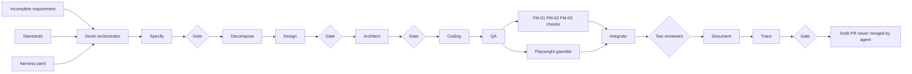

# Substation Asset Manager — AngularJS → Angular migration pilot (day-zero repo)



Full-size diagram: [docs/flowchart.html](docs/flowchart.html) · [docs/flowchart.png](docs/flowchart.png)

A realistic, working **protection & control asset-management web application** for an electricity transmission estate — substations, bays, protection relays / IEDs, firmware approval and end-of-life, settings-file history with version comparison, IEC 61850 SCL import (`.icd` `.cid` `.scd` `.ssd` `.iid`), COMTRADE disturbance-record inventory and an append-only audit trail.

It is deliberately frozen at the **before-state** of an Angular migration: an AngularJS 1.8 client (`$scope` controllers, a `$rootScope` event bus, a DOM-manipulating directive, locale-aware filters, Karma/Jasmine, Protractor leftovers) in front of a Spring Boot 3 / JPA / Flyway asset service with a committed OpenAPI contract. The repo also carries the governance scaffolding an **agentic SDLC harness** needs to take an incomplete migration requirement through Specify → Decompose → Design → Architect → Coding → QA → Integrate → Document → Trace, stopping at human gates and ending in a reviewed, traced, merge-ready *draft* PR.

## What the demo shows

1. **Day zero.** `main` is the legacy app, running. The only input is [requirements/customer/angular-migration-requirement.md](requirements/customer/angular-migration-requirement.md) — a genuinely incomplete, partly self-contradicting migration request (server-side comparison vs "no API changes", exact equality vs tolerance, who may read a comparison, an unmeasurable performance target).
2. **The mechanism, not a feature.** [harness.yaml](harness.yaml) and [docs/HARNESS_CONTRACT.md](docs/HARNESS_CONTRACT.md) define nine stages, five human gates, stable ids (`REQ-<FEATURE>-nnn` → `DES-` → `TST-`), draft-PR-only output, the `ai-generated` label, two-reviewer protection for auth/audit/migration paths and commit trailers. Standards live in [standards/](standards/).
3. **Failure modes are caught by tooling, not by hoping.** [tools/checks](tools/checks) implements FM-01 (business logic creeping into controllers/components, ratcheted against a day-zero baseline), FM-02 (error handling removed in a diff) and FM-03 (null/undefined API fields silently coerced to `0`/`""`). Day zero intentionally has findings; the ratchet only moves down.
4. **The UI gauntlet is mandatory.** [tests/ui](tests/ui) holds six Playwright scenarios with real protection-engineering content (an 87T slope outside its permitted range, a de-DE decimal comma, a refurbished-bay `.scd`, a VIEWER denied a COMTRADE download) — see [tests/ui/UI_TEST_PLAN.md](tests/ui/UI_TEST_PLAN.md). Hooks are `data-test` attributes and must survive the migration.
5. **Finale.** Devin runs the gauntlet headless, then click-tests the migrated screens live in a visible browser and posts the screenshots and recording on the draft PR.

## Devin's role — the runtime, not just the author

Devin is the orchestrator (reads `harness.yaml`, spawns one child session per stage, stops at every gate) **and** every stage agent. Nothing in this repo assumes another agent runtime. Repo-local skills under [.agents/skills](.agents/skills) make the procedure enforceable: how to run the stack, where stage artefacts go, how to run the checks and the gauntlet. Agents open **draft** PRs only and never merge.

Single-session fallback (if child sessions are unavailable):

> Read harness.yaml and docs/HARNESS_CONTRACT.md. Take requirements/customer/angular-migration-requirement.md through every stage in order on one branch, writing each stage's artefacts to harness/<stage>/ and stopping at each human gate with a GATE marker. Run tools/checks/run_all.py and the tests/ui gauntlet before Integrate. Open a draft PR labelled ai-generated with governance trailers. Do not merge.

## Run it

Prerequisites: Java 17, Maven 3.9, Node 20, Python 3.10+, Chrome/Chromium (Karma, Playwright). Or Docker.

```bash
# Backend (H2, seeded by Flyway) — http://localhost:8080
cd backend && mvn spring-boot:run

# Frontend (static server + /api proxy) — http://localhost:3000
cd frontend && npm ci && npm start

# Or both halves + PostgreSQL
docker compose up --build        # MAVEN_MIRROR=<url> docker compose up --build  if Maven Central rate-limits you
```

Sign in by picking a user in the top-right switcher (demo auth: `X-SAM-User` header). `rvasquez` is PROTECTION_ADMIN, `mbrandt`/`aokafor` are engineers, `lchen` is a VIEWER, `sdubois` an AUDITOR.

```bash
cd backend  && mvn test                      # JUnit · OpenAPI contract · ArchUnit layering (53 tests)
cd frontend && npm run lint && npm test      # ESLint (angular plugin) · Karma/Jasmine
python3 tools/checks/run_all.py --base origin/main   # FM-01..03
cd tests/ui && npm ci && npx playwright install chromium && npx playwright test   # gauntlet S1–S6 (stack must be up)
```

CI ([.github/workflows/ci.yml](.github/workflows/ci.yml)) runs all of the above on every push and PR.

## Repository layout

```
api/openapi.yaml            committed interface contract (IC-01); contract tests fail when it drifts
backend/                    Spring Boot 3 asset service — domain, Flyway seed, SCL parser, settings/records/audit APIs
frontend/                   AngularJS 1.8 client — ui-router screens, $scope controllers, event bus, directives, filters, Karma
frontend/test/e2e/          Protractor-era leftovers (not run; Protractor is end-of-life)
requirements/customer/      the incomplete migration requirement (harness input)
standards/                  CODING_STANDARD · INTERFACE_CONTRACT_STANDARD · UI_MIGRATION_GUIDELINES
harness.yaml                stages, gates, ids, commands, checks
docs/                       HARNESS_CONTRACT · ARCHITECTURE · RUNBOOK · IMPLEMENTATION_PLAN · flowchart
tools/checks/               FM-01/02/03 failure-mode checks + ratchet baseline
tests/ui/                   Playwright gauntlet + UI_TEST_PLAN
.agents/skills/             repo skills Devin loads: run-the-stack, stage-outputs, failure-mode-checks, ui-gauntlet
docker-compose.yml          db (PostgreSQL 16) · backend · frontend
```

## Key concepts

- **IED / relay** — intelligent electronic device: a protection relay, bay controller or merging unit in a substation bay. Modelled with vendor, model, firmware, lifecycle status and IEC 61850 logical nodes (`PDIF`, `PTOC`, `PDIS`, `XCBR` …).
- **Settings file** — a versioned relay configuration (`v1`, `v2`, `v3` …). Exactly one version is ACTIVE per IED; uploads are validated against each setting's permitted range. Comparison (currently client-side, in a controller — the thing the migration must move) classifies rows as changed / added / removed / unchanged and flags range violations first.
- **SCL import** — IEC 61850 System Configuration Language files describing IEDs and their data model; parsed namespace-aware with XXE disabled, then matched to inventory IEDs.
- **COMTRADE record** — a disturbance (fault) recording as `.cfg/.dat/.hdr`; downloads are role-checked and audited.
- **Audit trail** — append-only `audit_event` rows for every mutation, with actor, outcome and before/after detail.
- **Harness** — the stage/gate/trace mechanism described in `harness.yaml`; see `docs/HARNESS_CONTRACT.md`.

Fictional operator, estate, people and data throughout.
