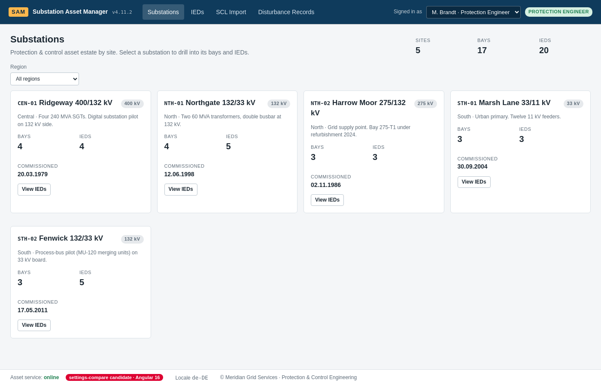

# Hybrid (ngUpgrade) spike — findings

A throwaway branch (`spike/hybrid-ngupgrade`, commit `948983d`, since deleted) proved that one Angular 16 component renders inside this AngularJS 1.8 shell with the Playwright gauntlet still 6/6 and zero console errors. The branch was deleted on purpose: `main` must stay the day-zero state. This note is what the Architect stage should reuse.

## What was needed (≈60 lines)

1. **Remove `ng-app="sam"` from `index.html`.** Angular owns bootstrap; `UpgradeModule.bootstrap(document.documentElement, ['sam'], { strictDi: true })` runs from `ngDoBootstrap()`. Leaving `ng-app` in place double-bootstraps and ui-router throws.
2. **`strictDi: true` works today** because every controller/service/directive in `frontend/src/app` uses array-annotated injection. Keep it on; the ESLint `angular/di` rule guards it.
3. **ui-router keeps the URL.** Do **not** import `RouterModule`; the Angular Router and `$urlRouter` fight over `hashchange`. Angular components are mounted by downgrading them into ui-router views (`downgradeComponent`) until the last AngularJS state is gone (UM-09).
4. **Build without the Angular CLI** (esbuild IIFE bundle, JIT compiler included) is fine for a spike but **constructor DI emits no metadata → NG0202**. Use `inject()` or `@Inject(...)`; the real migration should use the Angular CLI / AOT where decorators are compiled.
5. **Load order:** AngularJS + app scripts first, the Angular bundle last; `angular.module('sam').directive('samHybridBadge', downgradeComponent(...))` must run before bootstrap.
6. **zone.js** must be imported once, before Angular; the AngularJS `$http` interceptor still runs unchanged and `X-SAM-User` is unaffected.
7. **Gauntlet impact: none.** No `data-test` hook changed; the sticky-header clone still strips hooks; S1–S6 passed unchanged against the Compose PostgreSQL backend.

## Not proven (Architect must decide)
- Sharing the `$rootScope` event bus with Angular (`downgradeInjectable` of an RxJS Subject).
- Replacing `ngAnimate` transitions on downgraded components.
- Bundle size: the JIT bundle was 1.8 MB unminified; AOT with the CLI is expected.
